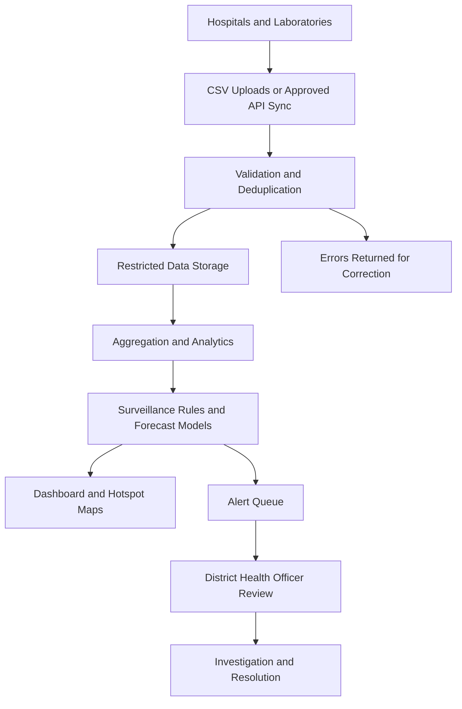

# 🏥 Hospital-Connected Disease Surveillance and Early-Warning Platform

## 🎯 Overview

The **Hospital-Connected Disease Surveillance and Early-Warning Platform** is a proposed AI-powered public health system designed to connect **hospitals, diagnostic laboratories, and district health departments**.

Hospitals will **upload patient and laboratory records or automatically synchronize data** through approved integrations. The platform will use **Machine Learning (ML), geographic analysis, and surveillance rules** to monitor **malaria and typhoid**, forecast case trends, identify potential hotspots, and generate alerts for **district health officers**.

The platform aims to help health teams identify unusual increases in reported cases, investigate affected areas, and prioritize response resources.

> **Project status:** Research and planning stage. The features below describe the intended product; a runnable application and validated prediction models are not yet available in this workspace.

⚠️ **Disclaimer:** This project is currently for **educational, research, and prototyping purposes**. Predictions and alerts require evaluation and authorized professional review before operational use. The platform does not provide prescriptions or replace clinical diagnosis or laboratory confirmation.

**Disease scope:** Malaria is primarily mosquito-borne, so the platform uses the broader term **disease surveillance** rather than describing both diseases as waterborne. [WHO malaria fact sheet](https://www.who.int/news-room/fact-sheets/detail/malaria).

## ✅ Quick Start Checklist with Links

- Review the [Research Foundation](#-research-foundation).
- **Watch the Introduction** [Video 1](https://youtu.be/_mAb_7StI1U?si=XqX-cS35eBp0St0G). [-Video 2](https://youtu.be/1fB6xxwRAnI?si=Q-2lJQif40XmLCXQ).
- View the [Dashboard Reference](#-dashboard-reference).
- Define the [Data Requirements](#-data-requirements) with participating hospitals.
- Follow the [Development Plan](#-development-plan).
- Related work Review Sheet [Related work Review Sheet](https://docs.google.com/spreadsheets/d/17c9r8ydv93V2gInOBzJR9l85RrYYYptdluYYziDOTv8/edit?usp=sharing).
- Agree on case definitions, reporting frequency, alert ownership, and authorized data use.
- Prepare synthetic data for the initial prototype.

---

## 🤝 Contributing

We welcome suggestions and contributions to this list of Water-borne diseases!

### ✅ How to Contribute

1. **Fork** this repository.
2. **Add your Projects Folder** in the repo (For example- ALI- Fall 2026).
3. Include the following details:
   - Folder Name **Student Name-Fall 2026-BC123244** (Student ID)- include following files
     - A **Details description of your project ( ReadMe.md file) **
     - Complete Code
     - Complete Diagram
4. Create a **Pull Request (PR) after Final Viva** with a clear title and description of your changes.
5.  Please read:[CONTRIBUTING.md](https://github.com/dr-mushtaq/Water-borne-diseases/blob/main/CONTRIBUTING.md)

---

### 💡 Alternative: Suggest via GitHub Issues

If you're not familiar with Git or Pull Requests, you can still contribute:

- Open a **GitHub Issue** with the following format:
- Sent email : mushtaq.hussain@vu.edu.pk

---
<details>
<summary>

## 🎯 Objectives

- Enable **hospital and laboratory data uploads and automated synchronization**.
- Monitor **suspected and confirmed malaria and typhoid cases** separately.
- Develop **area-level disease risk estimates and case forecasts**.
- Identify **geographic hotspots and unusual increases in reported cases**.
- Generate **early-warning alerts for district health officers**.
- Provide **interactive dashboards and aggregate surveillance reports**.
- Support a **mobile-friendly web interface and approved API integrations**.
- Build a **scalable, modular platform with controlled data access**.

---

**Setup status:** Installation commands will be added when application code and dependencies are available. This workspace currently contains documentation, the reference paper, and the dashboard image.

## 🏗️ System Architecture




### 1. Disease Surveillance and Analytics Engine

- Collect and validate disease and laboratory records from participating facilities
- Analyze suspected and confirmed cases by disease, location, and reporting period
- Compare recent case counts with historical or seasonal baselines
- Explore forecasting and hotspot-detection approaches
- Generate signals for review by authorized public health personnel

### 2. Hospital and Laboratory Reporting

- Accept standardized data through CSV uploads
- Support future integration with approved hospital and laboratory systems
- Validate required fields, dates, disease classifications, and test results
- Identify duplicate submissions and track corrections
- Report missing or delayed facility submissions

### 2. AI and Early-Warning Engine

- Aggregate case records by disease, geographic area, and reporting period.
- Compare current observations with historical and seasonal baselines.
- Evaluate candidate models for **future case counts and area-level risk**.
- Display forecast horizons and uncertainty intervals.
- Generate alerts when approved surveillance thresholds are exceeded.
- Record model versions, triggering rules, and supporting evidence.

### 3. Surveillance Dashboard

- Provide disease filters for **malaria and typhoid**.
- Display case summaries, time trends, geographic patterns, and active alerts.
- Show reporting coverage and the latest data refresh time.
- Offer separate views for hospital staff and district health officers.
- Support acknowledgment, investigation notes, assignment, and alert closure.
- Display case summaries, trends, geographic patterns, and alerts
- Provide separate views for malaria and typhoid
- Show reporting coverage and the latest data update
- Help health teams review and investigate unusual changes

### 4. Data and Analytics Layer

- Store validated records with source and import history.
- Maintain aggregate surveillance datasets and geographic boundaries.
- Store forecasts, alert history, and audit records.
- Apply role-based access and organization boundaries.
- Support authorized aggregate reporting and reproducible model evaluation.

## 📌 Key Features
 
| Area | Planned capabilities |
| --- | --- |
| 🦠 **Disease surveillance** | Malaria and typhoid tracked separately; suspected vs. confirmed cases; observed data kept apart from forecasts |
| 🏥 **Hospital & lab reporting** | Standardized uploads, validation with error summaries, completeness and data-freshness tracking, future connections to approved systems |
| 🗺️ **Geographic monitoring** | Cases by approved district or locality; residence area distinguished from reporting facility; missing or delayed reports shown when reading maps |
| 🚨 **Early-warning signals** | Comparison with agreed reference levels; recorded alert reason and review status; alerts treated as prompts for investigation, **not** outbreak confirmation |
| 📊 **Insights & reports** | Case, test, and trend summaries; authorized aggregate reports; limitations and missing data kept visible |
| 🌐 **Extensibility** | Additional diseases and facilities; desktop and mobile access; versioned data, models, and alert rules |
 
---

## 🖼️ Dashboard Reference


*User-supplied research dashboard reference. The displayed figures are reference content, not current surveillance data or results from an implemented application in this repository.*

## 🧪 Example Interaction

**Illustrative example using fictional data:**

A reporting facility submits a weekly file with typhoid test results for a demonstration district.

**System processing:**

- Checks the file for required fields and invalid values
- Identifies possible duplicate records
- Summarizes reported cases for the period
- Compares the summary with an agreed surveillance reference level
- Flags an unusual increase for review

**Illustrative system output:**

```text
Disease: Typhoid
Area: Demonstration District
Reporting Period: Most recent complete week
Reported Confirmed Cases: 24
Reporting Coverage: 4 of 5 expected facilities
Signal: Configured reference level exceeded
Status: Awaiting authorized public health review
Suggested next step: Check data quality and investigate the increase
```

The example values are fictional. A signal does not independently confirm an outbreak or provide a diagnosis.

### Proposed Dashboard Layout

| Panel | Planned Content |
| --- | --- |
| **Navigation** | Overview, Malaria, Typhoid, Hospitals & Labs, Uploads & Sync, Hotspots, Alerts, Reports |
| **Filters** | Disease, district, facility, date range, and case status |
| **Summary Cards** | Confirmed cases, suspected cases, tests performed, active alerts, reporting completeness |
| **Hotspot Map** | Geographic case distribution with reporting coverage and a separate forecast-risk layer |
| **Trend Charts** | Historical observations, future forecasts, and uncertainty intervals |
| **Hospital Reporting** | Expected submissions, latest successful sync, and validation errors |
| **Alert Management** | Trigger, severity, responsible officer, acknowledgment, and investigation status |

Filters should apply consistently across panels and exports. Missing reports must be distinguished from zero cases, and charts should have accessible table alternatives.

The patient prediction form in the reference is outside the initial operational MVP. A negative model estimate must never be displayed as proof that a patient is healthy.

## 🧰 Technology Stack

The following are **candidate technologies for future development**, not a claim that they are already installed or used by the project.

| Component | Candidate Tools |
| --- | --- |
| **Data Analysis** | Python, pandas, NumPy |
| **Statistical Models** | statsmodels, scikit-learn |
| **Forecasting Experiments** | Seasonal baselines, time-series models, XGBoost |
| **Backend** | FastAPI or Flask |
| **Frontend / Prototype Dashboard** | Streamlit or React |
| **Database** | PostgreSQL |
| **Geographic Analysis** | Leaflet, PostGIS |
| **Data and Model Versioning** | DVC, MLflow |
| **Deployment** | Docker, subject to hosting and governance requirements |
| **Data Exchange** | CSV uploads; approved APIs where available |

### Candidate Approaches for Surveillance

| Approach | Potential Use | Evaluation Considerations |
| --- | --- | --- |
| **Historical or Seasonal Baseline** | Compare current counts with previous periods | Use as a reference before adopting more complex models |
| **Time-Series Models** | Explore future aggregate case counts | Evaluate forecast error, uncertainty, seasonality, and reporting gaps |
| **Tree-Based Models** | Explore relationships between past counts and approved contextual data | Use time-based validation and prevent data leakage |
| **Threshold-Based Signals** | Flag increases for review | Evaluate missed events, false alerts, and reporting completeness |

No model should be described as accurate or production-ready without project-specific evaluation.

---

## 🗃️ Data Requirements

| Data Group | Example Fields | Purpose |
| --- | --- | --- |
| **Source Identity** | facility_id, source_record_id, record_updated_at | Trace records, deduplicate, and process corrections |
| **Authorized Linkage** | facility-scoped pseudonymous_patient_id, encounter_id | Link encounters and tests within the approved scope |
| **Dates** | encounter_date, specimen_date, result_date, received_at | Separate event timing from reporting delays |
| **Geography** | district_code, locality_code, facility_code | Support appropriate geographic aggregation |
| **Disease Classification** | disease_code, case_status, case_definition_version | Separate suspected and confirmed cases |
| **Laboratory Results** | test_type, result, result_status | Track test outcomes and subsequent updates |
| **Optional Demographics** | age_band, sex | Support justified aggregate subgroup analysis |
| **Provenance** | import_batch_id, source_system, schema_version | Maintain a reproducible audit trail |

Collect only data justified by the agreed surveillance purpose. Define repeat-test and disease-episode counting rules before producing totals. Facility-scoped identifiers do not establish identity across hospitals; cross-facility linkage requires a separately agreed method.

---

## 🚀 Development Roadmap
 
| Phase | Focus | Key activities |
| --- | --- | --- |
| **1. Prototype** | Foundations | Define case categories and reporting periods; document the data format; build validation and aggregate summaries on synthetic data; basic trend and coverage dashboard |
| **2. Evaluation** | Evidence | Check data quality and counting rules; compare forecasts against seasonal baselines using time-based test sets; report MAE, RMSE, and interval coverage; assess alert sensitivity, missed events, and false alerts; evaluate each disease separately |
| **3. Enhancement** | Usability | Improve geographic summaries; add completeness and freshness indicators; forecast charts with uncertainty; alert review and investigation tracking; stakeholder feedback |
| **4. Integration & pilot** | Real-world test | Identify an authorized pilot partner; test an approved data exchange; reconcile records with source; test monitoring, backups, access controls, and recovery |
| **5. Data & storage** | Reliability | Consistent schema and provenance; access controls, retention, and corrections; dataset and model-input versioning; document limits from missing or delayed reporting |
| **6. Governance & safety** | Trust | See [Governance and Safety](#-governance-and-safety) |
 
> Report results only after evaluation on suitable project data. Results from other datasets or projects must not be presented as this project's performance.
 
### 🔮 Future scope
- More hospitals, laboratories, and diseases (once case definitions and data exist).
- Environmental or weather data where relevance and quality are established.
- Multilingual, mobile-friendly, and offline-assisted reporting.
- Stronger district-level trend analysis and planning tools.
---


## 📚 Research Foundation

The project is inspired by [Machine learning based efficient prediction of positive cases of waterborne diseases](https://doi.org/10.1186/s12911-022-02092-1), published in *BMC Medical Informatics and Decision Making* in 2023.

The study analyzed malaria and typhoid patient records from Ayub Medical Hospital for 2017–2020 and proposed a warning/dashboard system to help health departments identify affected areas and predict positive cases.

Hospital synchronization, district forecasting, and operational alert management are proposed product extensions. The paper's patient-level classification results do not establish future outbreak forecasting performance.

📄 [Local research paper](s12911-022-02092-1.pdf)

## 📬 Contact

- **Email:** mushtaqmsit@gmail.com
- **LinkedIn:** [Mushtaq Hussain](https://www.linkedin.com/in/mushtaq-hussain-21417814/)
- **YouTube:** [Coursesteach](https://www.youtube.com/@coursesteach-mv5si)
- **Team ID:** themushtaq48


# Water-borne-diseases
**Related data**
1. [Interpreting Tree-Based Model's Prediction of Individual Sample](https://coderzcolumn.com/tutorials/machine-learning/treeinterpreter-interpreting-tree-based-models-prediction-of-individual-sample?fbclid=IwAR2-zcjOO-c3XfiDoG6eufSmBaFz9mnrislreMJF6NluNUAwZZWCWtM8kYI)
2. [Malaria Detection using Deep Learning | Python Final Year IEEE Project 2020 - 2021](https://www.youtube.com/watch?v=PHK9RrYfEQ4&ab_channel=JPINFOTECHPROJECTS)
3. [Build a system to identify fake news articles!](https://medium.com/nerd-for-tech/build-a-system-to-identify-fake-news-articles-6604968043cb)
4. [END TO END Machine learning Project deployment on Flask server.](https://www.youtube.com/watch?v=PH0M8ktKCRo)
5. [Live- Implementation of End To End Kaggle Machine Learning Project With Deployment](https://www.youtube.com/watch?v=p_tpQSY1aTs&ab_channel=KrishNaik)
6. [Car-Price-Prediction](https://github.com/krishnaik06/Car-Price-Prediction/blob/master/Untitled.ipynb)
7. [venugopalkadamba Multi_Disease_Predictor](https://github.com/venugopalkadamba/Multi_Disease_Predictor)
8. [End to End Deployment of Breast Cancer Prediction Through Machine Learning using Flask](https://medium.com/analytics-vidhya/end-to-end-deployment-of-breast-cancer-prediction-through-machine-learning-using-flask-a40abbabf1fe)
9. [Build a Machine Learning web application from scratch in Python with Streamlit.](https://morioh.com/p/28f32a0d90a2?f=5c21fb01c16e2556b555ab32&fbclid=IwAR2IEef_M-c4je1UrV1XE0EX-S6NX6j1ib2b6yHAc7LPMfAxuurdzaAxxdY)
10. [ditikrushnaEnd-to-End-Diabetes-Prediction-Application-Using-Machine-Learning](https://github.com/ditikrushna/End-to-End-Diabetes-Prediction-Application-Using-Machine-Learning)
11. [Disease-Prediction-from-Symptoms](https://github.com/anujdutt9/Disease-Prediction-from-Symptoms)
