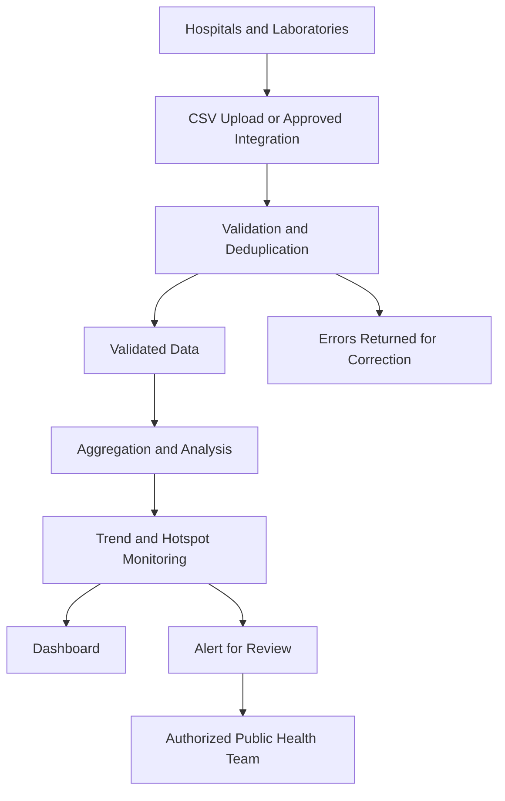

## 🏗️ System Architecture

### 1. Disease Surveillance and Analytics Engine

- Collect and validate disease and laboratory records from participating facilities
- Analyze suspected and confirmed cases by disease, location, and reporting period
- Compare recent case counts with historical or seasonal baselines
- Explore forecasting and hotspot-detection approaches
- Generate signals for review by authorized public health personnel

### 2. Hospital and Laboratory Reporting

- Accept standardized data through CSV uploads
- Support future integration with approved hospital and laboratory systems
- Validate required fields, dates, disease classifications, and test results
- Identify duplicate submissions and track corrections
- Report missing or delayed facility submissions

### 3. Surveillance Dashboard

- Display case summaries, trends, geographic patterns, and alerts
- Provide separate views for malaria and typhoid
- Show reporting coverage and the latest data update
- Help health teams review and investigate unusual changes

### 4. Data and Analytics Layer

- Store validated records and their source information
- Maintain aggregate summaries, model outputs, and alert history
- Support authorized reporting and reproducible evaluation
- Protect sensitive information through access controls and appropriate data handling



## 📌 Key Features

### 🦠 Disease Surveillance

- Monitor malaria and typhoid cases separately
- Distinguish suspected cases from confirmed cases
- Review disease trends across reporting periods and locations
- Keep observed data separate from forecasts or model estimates

### 🏥 Hospital and Laboratory Reporting

- Plan for standardized data uploads
- Validate incoming records and provide error summaries
- Track reporting completeness and data freshness
- Support future connections to approved health information systems

### 🗺️ Geographic Monitoring

- Summarize reported cases by approved district or locality boundaries
- Highlight unusual increases for further investigation
- Distinguish a patient's area of residence from the reporting facility
- Consider missing or delayed reports when interpreting geographic patterns

### 🚨 Early-Warning Signals

- Compare current case counts with agreed reference levels
- Flag unusual patterns for authorized personnel to review
- Record the reason for an alert and its review status
- Treat alerts as prompts for investigation—not as confirmation of an outbreak

### 📊 Data-Driven Insights

- Summarize suspected cases, confirmed cases, and test results
- Display trends and reporting coverage
- Support authorized aggregate reports
- Make limitations and missing data visible to users

### 🌐 Extensible Platform

- Design the system to support additional diseases and facilities
- Plan for web-based access across desktop and mobile browsers
- Allow future API integrations where approved and available
- Keep data, model, and alert-rule versions traceable

## 🧪 Example Interaction

**Illustrative example using fictional data:**

A reporting facility submits a weekly file with typhoid test results for a demonstration district.

**System processing:**

- Checks the file for required fields and invalid values
- Identifies possible duplicate records
- Summarizes reported cases for the period
- Compares the summary with an agreed surveillance reference level
- Flags an unusual increase for review

**Illustrative system output:**

```text
Disease: Typhoid
Area: Demonstration District
Reporting Period: Most recent complete week
Reported Confirmed Cases: 24
Reporting Coverage: 4 of 5 expected facilities
Signal: Configured reference level exceeded
Status: Awaiting authorized public health review
Suggested next step: Check data quality and investigate the increase
```

The example values are fictional. A signal does not independently confirm an outbreak or provide a diagnosis.

## 🧰 Technology Stack

The following are **candidate technologies for future development**, not a claim that they are already installed or used by the project.

| Component | Candidate Tools |
| --- | --- |
| **Data Analysis** | Python, pandas, NumPy |
| **Statistical Models** | statsmodels, scikit-learn |
| **Forecasting Experiments** | Seasonal baselines, time-series models, XGBoost |
| **Backend** | FastAPI or Flask |
| **Frontend / Prototype Dashboard** | Streamlit or React |
| **Database** | PostgreSQL |
| **Geographic Analysis** | Leaflet, PostGIS |
| **Data and Model Versioning** | DVC, MLflow |
| **Deployment** | Docker, subject to hosting and governance requirements |
| **Data Exchange** | CSV uploads; approved APIs where available |

### Candidate Approaches for Surveillance

| Approach | Potential Use | Evaluation Considerations |
| --- | --- | --- |
| **Historical or Seasonal Baseline** | Compare current counts with previous periods | Use as a reference before adopting more complex models |
| **Time-Series Models** | Explore future aggregate case counts | Evaluate forecast error, uncertainty, seasonality, and reporting gaps |
| **Tree-Based Models** | Explore relationships between past counts and approved contextual data | Use time-based validation and prevent data leakage |
| **Threshold-Based Signals** | Flag increases for review | Evaluate missed events, false alerts, and reporting completeness |

No model should be described as accurate or production-ready without project-specific evaluation.

## 🚀 Development Plan

### Phase 1: Prototype

- Review the available datasets, notebooks, diagrams, and project documents
- Define the disease case categories and reporting periods
- Create a documented data format; use synthetic data for early demonstrations
- Build an initial workflow for data validation and aggregate summaries
- Create a basic dashboard for trends and reporting coverage

### Phase 2: Evaluation

- Check data quality, missing values, duplicate handling, and case-counting rules
- Compare forecasting approaches with simple historical or seasonal baselines
- Use time-based test sets to evaluate forecasts on later reporting periods
- Consider MAE, RMSE, and prediction-interval coverage for forecasting
- Evaluate alert sensitivity, missed events, and false-alert frequency
- Assess malaria and typhoid separately

> Results must be reported only after evaluation on suitable project data. Results from other datasets or projects should not be presented as this project's performance.

### Phase 3: Enhancement

- Improve dashboard usability and geographic summaries
- Add reporting-completeness and data-freshness indicators
- Explore forecast visualizations with uncertainty information
- Add alert review and investigation tracking
- Collect feedback from relevant public health stakeholders

### Phase 4: Integration and Pilot

- Identify an authorized pilot partner and define permitted data use
- Test an approved hospital or laboratory data exchange
- Reconcile uploaded or synchronized records with their source
- Test monitoring, backups, access controls, and recovery procedures
- Review pilot results before considering wider deployment

### Phase 5: Data and Storage

- Define a consistent data schema and data provenance requirements
- Establish appropriate access controls, retention, and correction procedures
- Protect sensitive data and collect only what is needed for the defined purpose
- Track dataset versions and model inputs for reproducible evaluation
- Document limitations caused by missing or delayed reporting

### Phase 6: Governance and Safety

- Agree on data-sharing authority, permitted uses, and responsible personnel
- Review applicable local privacy, health-data, and regulatory requirements with qualified partners
- Document intended use, system limitations, and human review responsibilities
- Require authorized public health review before acting on surveillance signals
- Do not claim regulatory approval or legal compliance unless it has been independently established

## 🔮 Future Scope

- Integrate additional hospitals and diagnostic laboratories
- Add other diseases when suitable data and case definitions are available
- Explore environmental or weather data where its relevance and quality are established
- Add multilingual and mobile-friendly reporting workflows
- Support offline-assisted reporting for facilities with limited connectivity
- Improve district-level trend analysis and public health planning tools
- Evaluate forecasting and alerting approaches through supervised research

## 📬 Contact

For queries or collaboration:

- 📧 **Email:** mushtaqmsit@gmail.com
- 💼 **LinkedIn:** [Mushtaq Hussain](https://www.linkedin.com/in/mushtaq-hussain-21417814/)
- 🎥 **YouTube:** [Coursesteach](https://www.youtube.com/@coursesteach-mv5si)
- **Team ID:** themushtaq48

## ⭐ Support

If you find this project useful, please ⭐ star the repository and share it.

## ⚠️ Important Note

This project is intended for educational, research, and prototyping purposes.

- ❌ It does not diagnose individual patients
- ❌ It does not independently confirm an outbreak
- ❌ It should not be the sole basis for clinical or public health decisions
- ✅ Surveillance results and alerts require appropriate review by qualified personnel